# XZ1 DSD Player

**安卓本地无损 / DSD 播放器 · 用户态 UAC2 独占输出（libusb）**

一台老手机（Sony XZ1，Snapdragon 835，官方停在 Android 9）接 USB DAC，做成"随身数播"：
不经过 Android 的 AudioFlinger / 混音器，把 PCM 与 DSD 位流**逐位**送到 DAC。

> An Android bit-perfect player for USB DACs: exclusive UAC2 output implemented in userspace
> with libusb (no AudioFlinger), DSD Native + DoP, true 24-bit FLAC, a WebDAV streaming library
> and Qobuz integration. See [English summary](#english-summary) at the end.

<p align="center">
  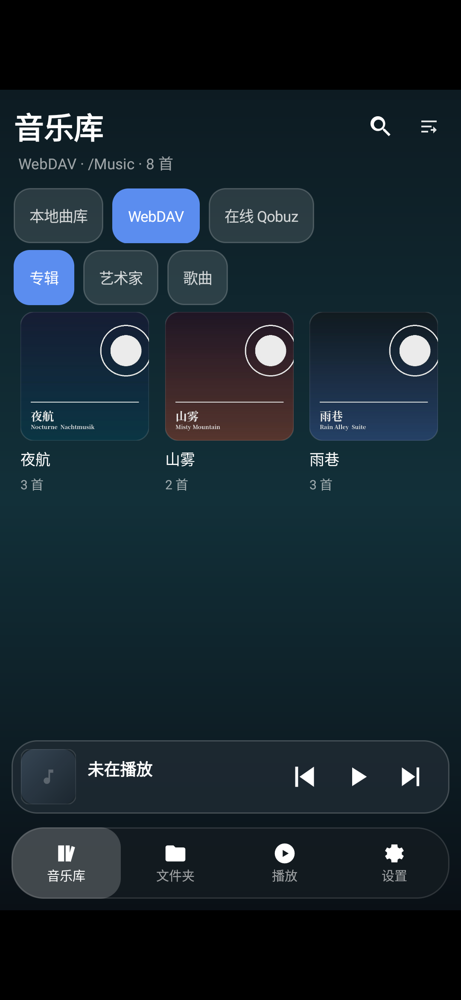
  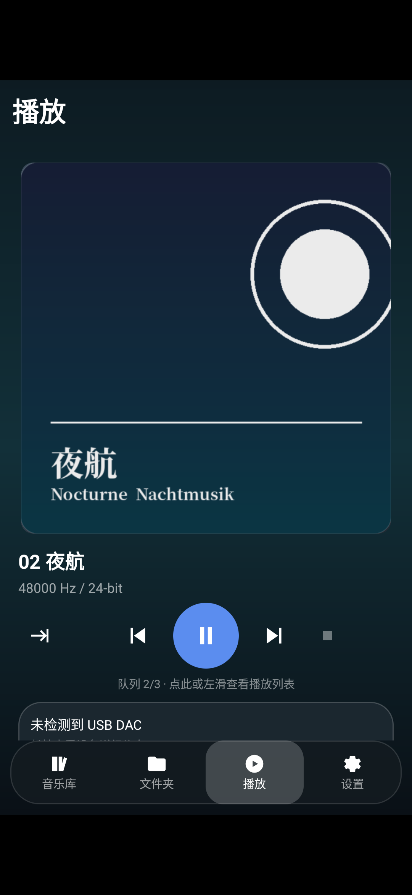
  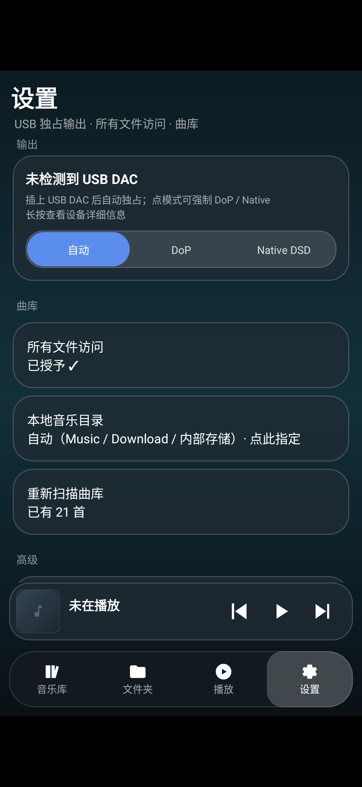
</p>

---

## 目录

- [为什么做这个](#为什么做这个)
- [功能一览](#功能一览)
- [界面](#界面)
- [亮点与技术实现](#亮点与技术实现)
- [支持格式](#支持格式)
- [构建与运行](#构建与运行)
- [使用要点](#使用要点)
- [已知限制](#已知限制)
- [法律与合规](#法律与合规)
- [工程笔记](#工程笔记)
- [开源许可](#开源许可)
- [目录结构](#目录结构)

---

## 为什么做这个

Android 默认把音频送进 AudioFlinger，再由系统混音后交给 USB 声卡：采样率可能被重采样、
位深会被截断、系统通知和其它 App 的声音会混进来。想接 DAC 听 DSD / 24bit 母带，这条路不行。

这个项目的做法是**绕开系统音频栈**：

```
App ──解码成 PCM(24-in-32) / DSD 位流──► libusb 等时泵 ──URB──► USB DAC
                                           ▲
                               detach 内核 snd-usb-audio，claim UAC2 接口
```

- 播放期间该 DAC **被本应用独占**，系统其它 App 无法使用（也不会混音）
- 停止 / 退出时 `setInterface(alt 0)` + `releaseInterface` + `attach_kernel_driver` 归还
- DSD 走两条路：**Native**（UAC2 GENERIC Type-I DSD，原率位流）与 **DoP**（几乎任何 24bit DAC 可用）

## 功能一览

| 分类 | 能力 |
|---|---|
| **输出** | 用户态 UAC2 独占（libusb 1.0.28）；等时泵 6×8×125µs 预提交；2 MB 环形缓冲；欠载补静音；暂停 10 ms 淡入淡出 |
| **DSD** | DSF / DFF 解封装；DSD Native（DSD64~512）与 DoP（176.4k/352.8k/705.6k）；优先 Native 自动回退 DoP；DoP 静音帧保持 DAC 锁定 |
| **PCM** | 统一输出 **24-bit-in-32**（USB 帧 2ch×4B）；16/24/32bit 与 float 源都能正确扩位；**真 24bit FLAC**（自研切帧 + float 解码） |
| **格式** | FLAC、WAV、AIFF、ALAC、AAC/m4a、DSF、DFF（DST 压缩除外） |
| **曲库** | MediaStore + 目录浏览；专辑/艺术家/歌曲/流派/年份；搜索、排序（专辑/年份/标题/添加时间/修改时间）、布局（紧凑/标准列表，2/3/4 列网格，默认 3 列） |
| **多来源** | 顶部来源切换：**本地曲库 / WebDAV / 在线 Qobuz**，三者共用同一套卡片、搜索与排序 |
| **WebDAV** | PROPFIND 扫库（深度 10，最多 4000 目录 / 20000 文件）；点击=**直接流播**（Range 随机读，不下载）；长按=下载到 `Music/WebDAV/…`；目录 `cover.jpg` 作专辑封面 |
| **Qobuz** | 登录自己的账号（网页登录抓 token 或粘贴 token）；搜索、专辑、曲目、收藏；优先 24bit/192k，取不到自动降档；收藏可导入本地 |
| **界面** | 单 Activity + 底部 tab（音乐库 / 文件夹 / 播放 / 设置）；横屏改左侧导航；播放队列左滑查看；播放模式 顺序/列表/单曲 |
| **两个 flavour** | `dsd`（独占播放器）与 `companion`（启动即「让出 USB 独占」，与官方 Apple Music 等共存，**可同时安装**） |

## 界面

| 音乐库（本地，3 列网格） | WebDAV 曲库（目录封面） | 专辑详情 |
|---|---|---|
| 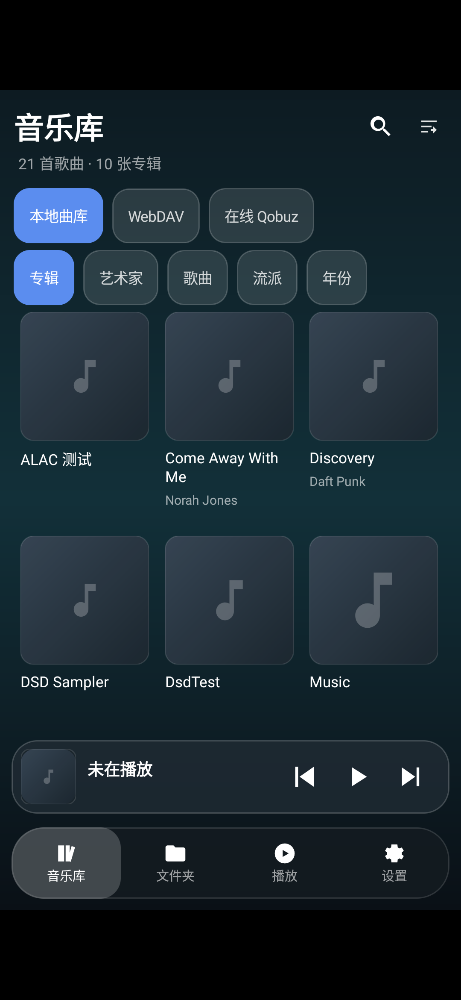 |  | 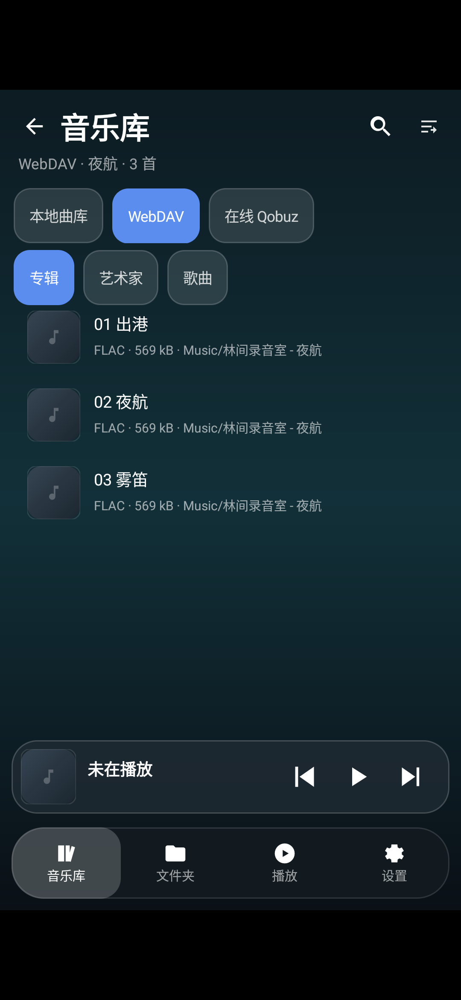 |

| 歌曲列表（流播来源） | 文件夹（本地 + WebDAV 远程） | 设置 |
|---|---|---|
| 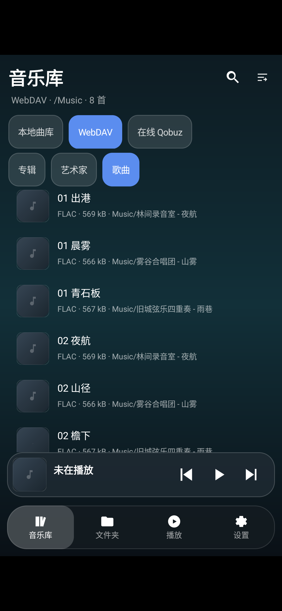 | 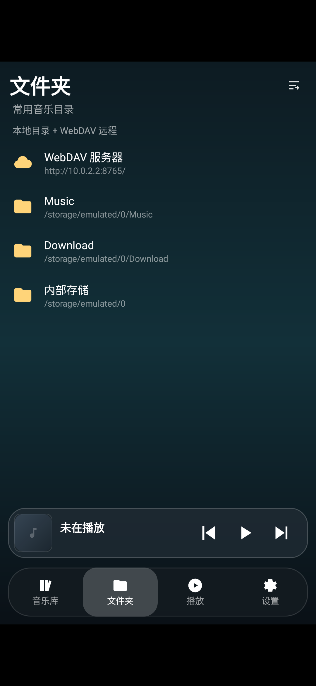 |  |

| 播放页（24bit FLAC 流播） | 列表形态的专辑行 | 横屏（左侧导航栏） |
|---|---|---|
|  | 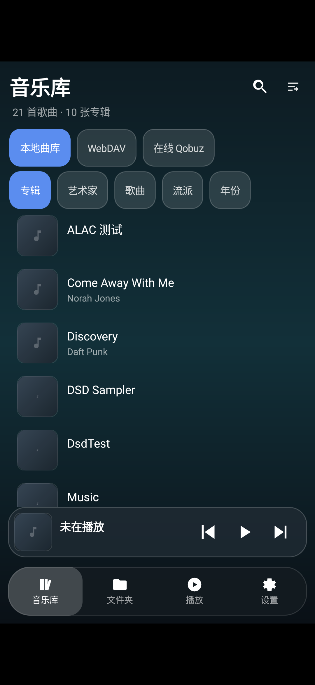 | 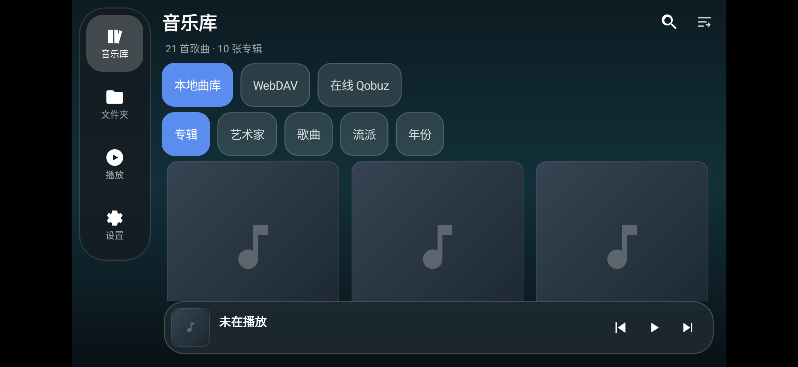 |

| 输出模式（自动 / DoP / Native） | 排序与布局面板 | 播放模式 / 进度 |
|---|---|---|
| 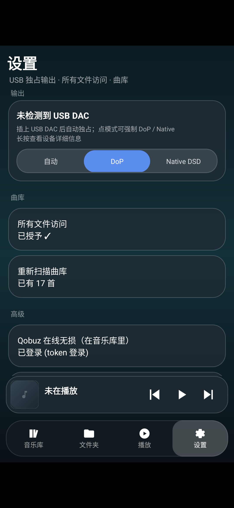 |  | 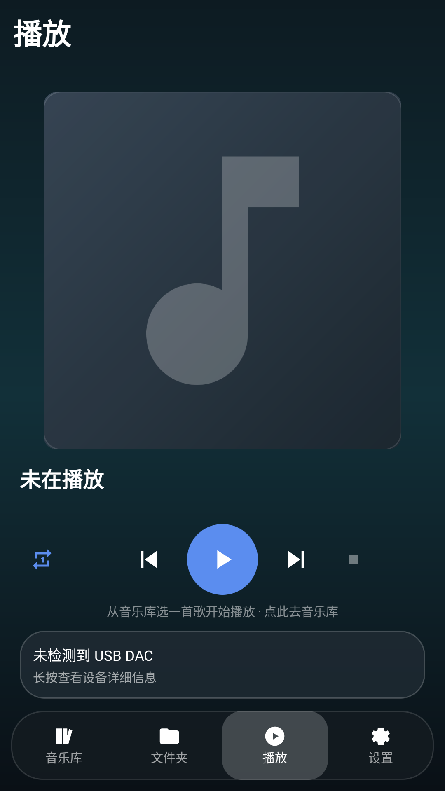 |

> 截图来自模拟器（没接 DAC，所以播放页底部的 DAC 卡片显示"未检测到 USB DAC"）。
> 真机上那一行会显示实际 DAC 型号、独占状态、协商到的位深与模式（`… 独占 · 24bit`）。
> 全部截图在 [`docs/screenshots/`](docs/screenshots/)（只保留不涉及第三方专辑封面的）。

## 亮点与技术实现

### 1. 用户态 USB 音频（UAC2）

- 描述符解析按 `bLength` 分支（≥8 / ==6 两种 FORMAT_TYPE 布局），取 subslot 与采样率表；
  DSD native 靠 `bmFormats` bit31 判定（不能看 `bFormatType`）
- 每微帧字节数用**整数累加**交替（44.1k×8B → 44,44,…,45），避免 0.227% 速率误差
- 采样率切换 `SET_CUR` 后 `GET_CUR` 读回校验，必要时尝试 ClockSelector
- 内核 `snd-usb-audio` 由 Java `claimInterface(force)` + native `detach_kernel_driver` 双重解绑

### 2. DSD：Native 与 DoP 双路

- DoP：32bit 子槽里 `marker` 在 bit31..24（L/R 交替 `0x05`/`0xFA`），16bit DSD 载荷在 bit23..8，
  最低字节恒 0；暂停/欠载继续送**合法 DoP 静音帧**（`00 69 69`），不掉锁定
- Native：UAC2 `GENERIC DSD` 格式（`SET_CUR` 直通位流），失败自动回退 DoP
- DSF 位反转、半文件 L/R 交织还原、DFF 的 PROP/SND/FRR8 解析全部在 native 侧完成

### 3. 真正的 24bit（不只是"显示 24bit"）

平台 FLAC extractor 会把 24bit 素材**降成 16bit** 解码（DAC 面板照样显示 24bit，但低 8 位恒 0）。
本项目对 24bit FLAC 走自研路径：

```
FlacFrameReader（样本号连续性 + CRC8 定界）
        │  帧对齐喂入（2 MB 顺序块切片）
        ▼
c2.android.flac.decoder（显式 KEY_PCM_ENCODING = FLOAT）
        │  float32
        ▼
clamp(f × 8388607) << 8  →  24-in-32  →  USB
```

配套三件套：**独立解码线程 + 6 MB 预读缓冲**（吸收网络抖动）、**seek 用重建解码器**
（`flush()` 会让 FLAC 解码器把已解码帧再吐一遍）、**吞吐/供数自检日志**（`x.xx×实时`）。
96k/24bit 流播实测：稳态 1.000×、`underrun` 从 ~270/s 降到 ~12/s、seek 精确到帧。

### 4. 流式（WebDAV / Qobuz）：边读边播，不落盘

- 自实现 `MediaDataSource`：Range 1 MB 块、一次补 2 块、LRU 24 MB、IPv4 优先 DNS、429/5xx 退避
- WebDAV 用 okhttp 发 `PROPFIND`（Android 的 `HttpURLConnection` 不允许自定义方法）
- WebDAV 曲库 BFS 扫库 + 音频白名单；目录 `cover.jpg` 直接当专辑封面（带 Basic 认证）
- Qobuz：私有 API + 每次取流现签名（`md5("trackgetFileUrl…")`），`app_id/secret` 运行时提取、
  **不写进仓库**，日志不打印 token

### 5. 界面

- 单 Activity + 四个 tab，横屏改左侧竖排导航；Material 3 深色
- 网格封面刷新靠 `URL + 尺寸` 做 tag 门控，避免复用 View 串图
- 播放页封面用"可用宽 / 剩余高"的**正方形**边长；迷你进度条宽度为 0 会被 ConstraintLayout 当
  match_constraint（用 1px + INVISIBLE）
- 切歌先把 position/duration 清零再渲染，避免迷你进度条按上一首的进度画满

## 支持格式

| 容器 | 位深 / 采样率 | 备注 |
|---|---|---|
| FLAC | 16 / 24bit，44.1k~192k | 16bit 走平台解码；24bit 走自研 float 路径（本地与流式都支持） |
| WAV / AIFF | 16 / 24 / 32bit | 自研 RIFF / AIFF 解析器（AIFF 仅未压缩 NONE） |
| ALAC（m4a/mp4） | 16 / 24bit | 平台有 `audio/alac` 用它，没有则用内置 Apple ALACDecoder（Apache-2.0） |
| AAC（m4a/aac） | 16bit | MediaCodec 解码，位深按实测输出处理（不猜） |
| DSF / DFF | DSD64~512 | Native 或 DoP；DFF 的 DST 压缩不支持 |

**暂不支持**：本地 `.mp3`、DST 压缩的 DFF、Apple Music 流（FairPlay）、TIDAL（已移除）、
DSD 网页直播（WebDAV 里的 DSF/DFF 只能下载后播）。

## 构建与运行

**环境**：JDK 17、Android SDK（compileSdk 35 / targetSdk 34 / minSdk 26）、NDK r27d、CMake 3.22。
仓库已带编译好的 libusb 静态库（`app/src/main/cpp/libs/<abi>/`），一般**不需要**重新编译它。

```bash
# 1) 指定 SDK 路径
echo "sdk.dir=$HOME/Android/Sdk" > local.properties

# 2) 两个 flavour（可同时装在一台机器上）
./gradlew assembleDsdDebug          # → app/build/outputs/apk/dsd/debug/app-dsd-debug.apk
./gradlew assembleCompanionDebug    # → app/build/outputs/apk/companion/debug/app-companion-debug.apk

# 3) 安装并授权
adb install -r app/build/outputs/apk/dsd/debug/app-dsd-debug.apk
adb shell appops set com.dsd.player MANAGE_EXTERNAL_STORAGE allow   # 或应用内点「所有文件访问」
```

### release 签名（发布 APK 用）

仓库里**不含任何密钥**。要出签名包，在项目根放一个 `keystore.properties`（已在 `.gitignore` 里）：

```properties
storeFile=/绝对路径/xz1-dsd-player.jks
storePassword=…
keyAlias=xz1dsd
keyPassword=…
```

```bash
./gradlew assembleDsdRelease assembleCompanionRelease
# → app/build/outputs/apk/<flavour>/release/app-*-release.apk（v2 签名）
```

没有这个文件时 `assembleDsdRelease` 仍能跑，只是产出未签名的 APK（CI 里够用）。
上传到 GitHub Release：`GITHUB_TOKEN=… scripts/github_release.sh`（见脚本头部说明，支持 `DRY_RUN=1`）。

要给别的 NDK / 新 ABI 重编 libusb：

```bash
NDK=/path/to/android-ndk-r27d LIBUSB=/path/to/libusb-1.0.28 scripts/build_libusb.sh
```

### 两个 flavour 的区别

| flavour | applicationId | 与其它 App 共存 | 说明 |
|---|---|---|---|
| `dsd` | `com.dsd.player` | 独占 USB | 原版：暂停时**保持**独占，最稳的位流输出 |
| `companion` | `com.dsd.player.companion` | 可共存 | 启动即开「让出 USB 独占」，暂停/停止时释放 DAC 给官方 Apple Music 等使用；仍可直接播本地 ALAC/m4a |

## 使用要点

1. **权限**：DSD 文件（`.dsf/.dff`）不属于媒体 MIME，分区存储下必须有「所有文件访问」才能在曲库
   里看到并可播放；只播 FLAC/WAV 的话不需要。
2. **USB 授权**：插入 DAC 时会弹权限框（勾选"默认"）；若刚插上就点播放，会等最多 2.5 秒再判定。
3. **DAC 能力**：设置页显示协商结果（`XD05 Bal · 独占 · 24bit`），长按 DAC 卡片看完整能力列表。
4. **输出模式**：自动 / DoP / Native DSD 三档；「自动」优先 Native，失败回退 DoP。
5. **WebDAV**：设置 → WebDAV 填 `http://主机:端口/路径` + 账号；"音乐目录"决定扫库根目录
   （填 `Music` 或留空表示根）。点击曲目=流播，长按=下载到 `Music/WebDAV/<专辑目录>/<曲名>`。
6. **Qobuz**：设置 → 在线音源（Qobuz）→ 网页登录（推荐）或粘贴 `user_auth_token`。
   收藏用本地库（Qobuz 写接口对本 app_id 不可用），可把账号里的收藏导入本地。
7. **不要同时插两个 DAC**（native 侧单设备句柄）。

## 已知限制

- **本地 `.mp3` 不支持**（扩展名白名单未包含，会报"不是 DSF/DSDIFF"）
- **DST 压缩的 DFF** 不支持：先 `ffmpeg -i in.dff out.dsf`
- **Apple Music 流**：FairPlay 加密，第三方拿不到 PCM；本项目用"让出 USB 独占"让官方 App 自己输出
- **WebDAV 里的 DSF/DFF 只能下载后播**（不做 DSD 网页流播）
- 采样率漂移只做水位重置，未做连续 ASRC 微调
- 无全局搜索（搜索只作用于当前来源）；无歌词、无均衡器
- release 构建未开 R8/minify（便于排障）；签名请自行配置

## 法律与合规

- **本项目不包含、也不会实现任何 DRM 绕过**。Apple Music 的无损/高解析是 FairPlay Streaming 加密，
  第三方无法取得解密后的 PCM；MusicKit / Apple Music API 只给元数据。`companion` flavour 的做法是
  **让出 USB 独占**，交由官方 Apple Music App 自己输出。
- **只播放你自己合法拥有的音频**：自购 CD 抓轨、iTunes 购买的 iTunes Plus（无 DRM ALAC）、
  自己购买的高解析下载，以及你自己有权访问的 WebDAV / Qobuz 账号内容。
- **Qobuz 支持使用其客户端私有接口**，`app_id/app_secret` 由使用者本机从 Qobuz 公开网页提取，
  仓库不含任何凭据、不含任何账号；请自行确认这符合你所在地区与 Qobuz 的服务条款。
- **不含遥测**：没有统计、崩溃上报或账号体系；WebDAV 密码与 Qobuz token 只存在本机
  SharedPreferences（已关闭 `allowBackup`，不随系统备份外带）。
  注意：这些凭据目前是**明文存储**，加密存储（EncryptedSharedPreferences）在计划中。
- 名称与商标（Sony / XD05 / Apple / iTunes / Qobuz 等）归各自所有者，本项目与其无隶属或背书关系。

## 工程笔记

所有"为什么这么写"（USB 等时泵、DoP marker、位深、flush 陷阱、流式供数、UI 踩坑）
整理在 [`docs/DEV-NOTES.md`](docs/DEV-NOTES.md)，每条都带症状，方便对照日志定位。

调试钩子（只在 **debug 构建**生效）：

```bash
# 不开 DAC 也能验解码链路（本地文件 / http 直链 / webdav:<路径>）
adb shell am start-foreground-service -n com.dsd.player/.playback.PlaybackService \
  -a com.dsd.player.SELFTEST --es path /sdcard/Music/x.flac --ei secs 12
adb logcat -s PlaybackService FlacFloat HttpFlac StreamByteSource
```

## 开源许可

本项目以 **GNU GPL-3.0** 发布，见 [LICENSE](LICENSE)。选它的原因很实际：静态链接了 LGPL-2.1 的
libusb，GPL-3.0 与之兼容且义务清晰。第三方组件与许可见 [THIRD-PARTY-NOTICES.md](THIRD-PARTY-NOTICES.md)。

欢迎 issue / PR。改动前建议先读 `docs/DEV-NOTES.md`——里面那些坑几乎都是"改了会静音/会变速/会崩"
的类型。

## 目录结构

```
app/src/main/
├── java/com/dsd/player/
│   ├── data/       曲库、WebDAV、Qobuz、偏好与全局状态（PlayerBus）
│   ├── decoder/    各容器解码（FLAC/WAV/AIFF/ALAC/DSD）+ 流式数据源 + 位深处理
│   ├── playback/   PlaybackService（前台服务、队列、MediaSession）、Producer（供数线程）
│   ├── ui/         MainActivity + 四个页面 + 适配器 + 自定义控件
│   └── usb/        UsbAudioOutput（独占/开流/热插拔）、NativeBridge（JNI）
├── cpp/
│   ├── native/     uac2_raw（描述符解析）、usb_stream（等时泵/环形缓冲）、dsd_native、alac_jni
│   ├── alac/       Apple ALACDecoder（Apache-2.0）
│   └── libs/       预编译 libusb 静态库（scripts/build_libusb.sh 生成）
└── res/            布局（含 layout-land 横屏）、drawable、values
docs/
├── DEV-NOTES.md    工程笔记（踩坑清单）
└── screenshots/    界面截图
scripts/            构建 libusb、生成测试素材、主机侧单测
```

---

## English summary

**XZ1 DSD Player** is an Android music player that outputs bit-perfect audio to USB DACs by
bypassing AudioFlinger: it claims the UAC2 interface through libusb in userspace (detaching
`snd-usb-audio`) and feeds the DAC from an isochronous pump backed by a ring buffer.

- **Formats**: FLAC (including *true* 24-bit via a self-built frame reader + float decode),
  WAV/AIFF, ALAC/m4a, AAC, DSF/DFF
- **DSD**: Native (DSD64–512) with automatic DoP fallback; correct DoP markers and silence frames
- **Sources**: local MediaStore library, WebDAV (stream + download + directory cover art),
  Qobuz (streaming from your own account, up to 24/192)
- **UI**: single-activity Material 3, four tabs, grid/list layouts, landscape rail, play queue,
  repeat modes
- **Two flavours**: `dsd` (exclusive) and `companion` (yields exclusivity so the official
  Apple Music app can drive the DAC, while still playing local ALAC)

No DRM circumvention, no telemetry, no bundled credentials. Licensed under **GPL-3.0**;
the list of platform pitfalls we hit is in [`docs/DEV-NOTES.md`](docs/DEV-NOTES.md).

---

**免责声明**：本项目为个人兴趣工程，按"现状"提供，不保证适配所有 DAC / ROM / 音频文件。
使用前请自行确认你的音源合法，并自行承担设备与数据风险。
